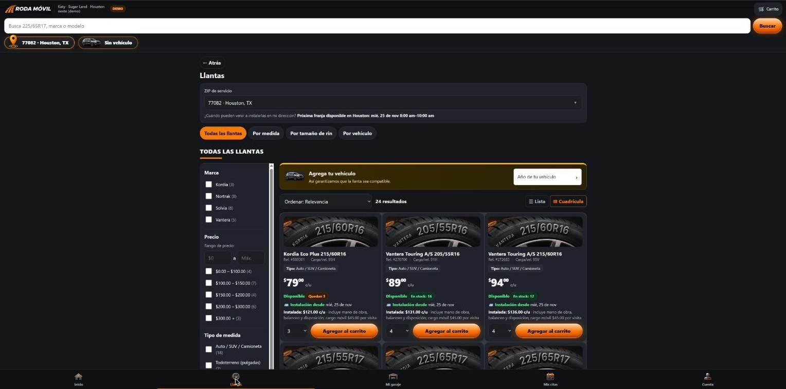

# RODA MÓVIL — Mobile Tire Service PWA (Demo)

> **Demo by ORVEXIA TECHNOLOGIES LLC.** RODA MÓVIL is a demo brand built to show a mini-app for a mobile tire business that works out of vans. Tire brands, prices, stock and payments in this demo are fictional or simulated.

## What it does

A Progressive Web App that lets customers buy and book tire service at home or work, with a shopping experience inspired by big auto-parts retailers:

- **Three ways in.** Buy tires with installation, install tires the customer already has, or book a flat-tire diagnosis and repair.
- **Service ZIP and next slot.** Pick a ZIP code to see the next available slot for that area. City and ZIP are kept consistent.
- **Find the right tire.** Search by size (auto/SUV, off-road in inches, commercial) or by Year → Make → Model → Trim. Includes a VIN lookup.
- **My Garage.** Save several vehicles and mark one as active, so every tire shows whether it fits.
- **Full catalog.** Filters by brand, price and size type, grid and list views, stock levels, and an installed price that includes labor, balancing, disposal and the mobile fee.
- **Booking flow.** Address with a van-space reminder, a time slot, and booking by WhatsApp Business or SMS. Customers book as guests.
- **Admin panel.** Manage sizes, ZIP codes and cities, with changes reflected instantly in the app.
- **Installable.** Manifest and service worker, so it runs like an app on the phone.

| Catalog | Mobile view |
|---|---|
|  |  |

## Tech

Vanilla JavaScript PWA (single page, hash routing) · Web App Manifest + Service Worker · NHTSA vPIC VIN decoding · US Car Models Data (CC BY 4.0) for years, makes and models · bilingual ES/EN.

## Notes

- This is a **demo**. Real payments (Stripe), a real tire-size data source, GPS tracking of the vans and the final legal texts are listed as production to-dos.
- This repository is a **portfolio showcase**: screenshots and a description. The source code is private.

## Built by

**ORVEXIA TECHNOLOGIES LLC**, Sugar Land, Texas. Designed and developed by Ernys Nápoles.

- Website: https://orvexiatech.com
- Portfolio: https://orvexia.dev
- Want a mini-app for your business? https://orvexiatech.com/services

© 2026 ORVEXIA TECHNOLOGIES LLC. All rights reserved.
